<a href="https://selzix.com">
  <picture>
    <source media="(prefers-color-scheme: dark)" srcset="assets/header-dark.svg">
    <source media="(prefers-color-scheme: light)" srcset="assets/header-light.svg">
    
  </picture>
</a>

  
  
  

I'm Mahidhar, a developer from India. I build and run my own products.

## [Selzix](https://selzix.com)

An online store for Indian sellers and hosts, on their own link. Sell products or rent out stays, and the payments go straight to your account with no Selzix fee. ₹999/month, first 14 days free.

## [@RingtoneRobot](https://t.me/RingtoneRobot)

A Telegram bot that sends you ringtones for any song or movie you name. Running since 2021, 1.5M+ users so far.

## Latest from the Selzix blog

<!-- BLOG-POST-LIST:START -->
- [Taking Cake Orders Online From Home: FSSAI, Cut-Offs and Pickup Slots](https://selzix.com/blog/home-bakery-online-orders-india)
- [What WhatsApp Order Updates Really Cost in India &lpar;2026 Rates&rpar;](https://selzix.com/blog/whatsapp-business-api-cost-india)
- [How to Start a Home Tiffin or Meal-Plan Service in India &lpar;2026&rpar;: Registration and Taking Weekly Orders](https://selzix.com/blog/how-to-start-tiffin-service-from-home-india)
- [How to Start a Cloud Kitchen From Home in India &lpar;2026&rpar;: Licences, Order Channels and a Launch Order](https://selzix.com/blog/how-to-start-cloud-kitchen-from-home-india)
- [Can You Sell Homemade Food Online in India? FSSAI, GST and What Your Website Must Show &lpar;2026&rpar;](https://selzix.com/blog/sell-homemade-food-online-legally-india)
<!-- BLOG-POST-LIST:END -->

<picture>
  <source media="(prefers-color-scheme: dark)" srcset="https://raw.githubusercontent.com/ursmahi/ursmahi/output/snake-dark.svg">
  <source media="(prefers-color-scheme: light)" srcset="https://raw.githubusercontent.com/ursmahi/ursmahi/output/snake.svg">
  
</picture>
