<a href="https://selzix.com">
  <picture>
    <source media="(prefers-color-scheme: dark)" srcset="assets/header-dark.svg">
    <source media="(prefers-color-scheme: light)" srcset="assets/header-light.svg">
    
  </picture>
</a>

  
  
  

I'm Mahidhar, a developer from India. I build and run my own products.

## [Selzix](https://selzix.com)

An online store for Indian sellers and hosts, on their own link. Sell products or rent out stays, and the payments go straight to your account with no Selzix fee. ₹999/month, first 14 days free.

## [@RingtoneRobot](https://t.me/RingtoneRobot)

A Telegram bot that sends you ringtones for any song or movie you name. Running since 2021, 1.5M+ users so far.

## Latest from the Selzix blog

<!-- BLOG-POST-LIST:START -->
- [How to get direct bookings as an Airbnb host in India, within the rules](https://selzix.com/blog/get-direct-bookings-airbnb-host)
- [Airbnb vs Booking.com vs MakeMyTrip &lpar;and Agoda&rpar; for homestay hosts in India](https://selzix.com/blog/airbnb-vs-booking-com-vs-makemytrip-for-hosts)
- [How to become an Airbnb host in India &lpar;2026&rpar;: rules, payouts, bookings](https://selzix.com/blog/how-to-become-airbnb-host-india)
- [Airbnb Host Fees in India &lpar;2026&rpar;: What You Pay on Every Booking](https://selzix.com/blog/airbnb-host-fees-india)
- [Taking Cake Orders Online From Home: FSSAI, Cut-Offs and Pickup Slots](https://selzix.com/blog/home-bakery-online-orders-india)
<!-- BLOG-POST-LIST:END -->

<picture>
  <source media="(prefers-color-scheme: dark)" srcset="https://raw.githubusercontent.com/ursmahi/ursmahi/output/snake-dark.svg">
  <source media="(prefers-color-scheme: light)" srcset="https://raw.githubusercontent.com/ursmahi/ursmahi/output/snake.svg">
  
</picture>
